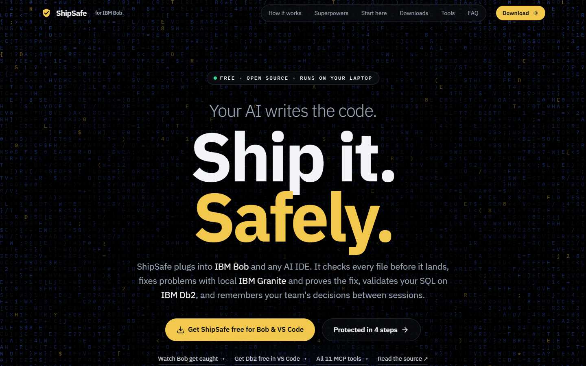
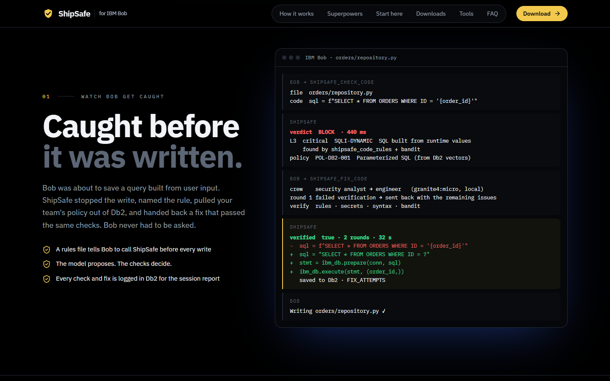
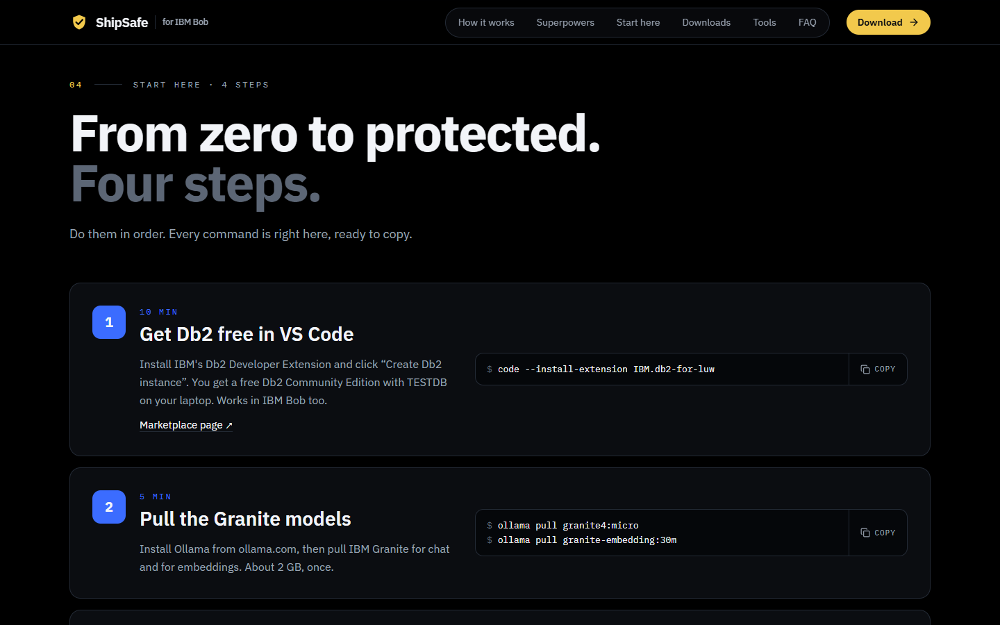
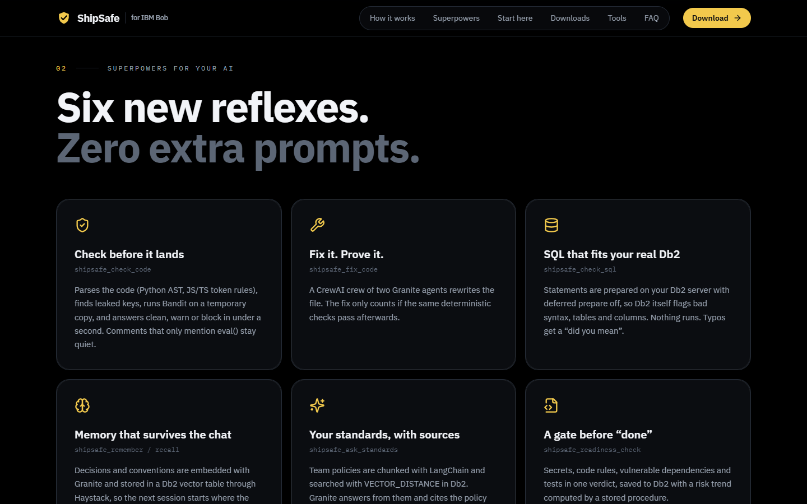
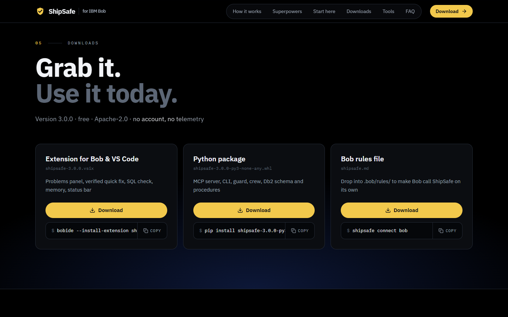
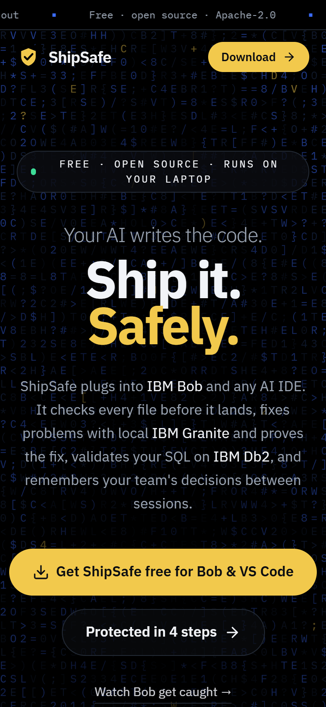

<div align="center">


# ShipSafe for IBM Bob

**Your AI writes the code. ShipSafe makes it shippable.**

The landing page and download hub for ShipSafe, a free MCP add-on that keeps code written by
IBM Bob (and VS Code, Claude Code, Cursor) production-ready, using IBM Db2 and local IBM Granite models.

[Download the extension](public/downloads/shipsafe-3.0.0.vsix) ·
[Download the Python package](public/downloads/shipsafe-3.0.0-py3-none-any.whl) ·
[Source code](https://github.com/ddevSharma/IBM_Db2_TechX_Project_Submission/tree/submission/shipsafe-ai/submissions/shipsafe-ai) ·
[Db2Hack submission](https://github.com/KunalGolaIBM/IBM_Db2_TechX_Project_Submission/pull/92)

</div>



## What ShipSafe does

| | |
|---|---|
| **Checks code before it lands** | Bob sends the file it is about to write; ShipSafe answers clean, warn or block in about 0.4 s, with the team policy behind each issue (from IBM Db2 vector search). |
| **Fixes it, then proves the fix** | A CrewAI crew on local Granite rewrites the file. The fix only counts if the same deterministic checks pass afterwards. |
| **Checks SQL against your real Db2** | Statements are prepared on the Db2 server (never executed); Db2 itself reports wrong tables and columns, with "did you mean" suggestions. |
| **Remembers decisions** | Team decisions live in a Db2 vector table (Haystack) and come back at the start of the next task. |
| **Answers with sources** | "What is our standard for X?" is answered by Granite from policies found with `VECTOR_DISTANCE` in Db2, with checked citations. |



## Downloads

Everything is free, open source (Apache-2.0) and runs locally.

| File | Install |
|---|---|
| [`shipsafe-3.0.0.vsix`](public/downloads/shipsafe-3.0.0.vsix): extension for IBM Bob and VS Code | `bobide --install-extension shipsafe-3.0.0.vsix` or `code --install-extension shipsafe-3.0.0.vsix` |
| [`shipsafe-3.0.0-py3-none-any.whl`](public/downloads/shipsafe-3.0.0-py3-none-any.whl): MCP server, CLI, Db2 schema | `pip install shipsafe-3.0.0-py3-none-any.whl` (Python 3.11–3.13) |
| [`shipsafe.md`](public/downloads/shipsafe.md): IBM Bob rules file | drop into `.bob/rules/`, or run `shipsafe connect bob` |

Quick start: get Db2 free with the IBM Db2 Developer Extension, `ollama pull granite4:micro` and
`ollama pull granite-embedding:30m`, install the wheel, run `shipsafe setup`, then `shipsafe connect bob`.
The full guide is on the page itself and in the
[getting-started doc](https://github.com/ddevSharma/IBM_Db2_TechX_Project_Submission/blob/submission/shipsafe-ai/submissions/shipsafe-ai/docs/getting-started.md).



## Screenshots

| Superpowers | Downloads | Phone |
|---|---|---|
|  |  |  |

## How this site is built

- **Vite 6 + React 19 + TypeScript**, styled with **Tailwind CSS v4**
- **React Bits** components for motion: DecryptedText (hero), CountUp (stats), SpotlightCard (capability cards),
  ShinyText, Magnet and ClickSpark (download button), plus a custom canvas "code glitch" backdrop
- **shadcn-style** UI primitives on **Radix**: tabs for each IDE, accordion FAQ, buttons and badges built with
  `class-variance-authority` and `tailwind-merge`
- **IBM Plex Sans / Mono**, self-hosted through Fontsource; respects `prefers-reduced-motion`
- Static output; the downloads are served from `public/downloads/` with attachment headers (`netlify.toml`)

```bash
npm ci
npm run dev        # http://localhost:5173
npm run build      # static site in dist/
```

## Deploy

**Vercel:** import this repository; `vercel.json` sets the Vite build (`npm run build` → `dist`) and the
download and security headers. **Netlify** works too, with the same settings in `netlify.toml`.
Every push to `main` redeploys.

## Updating the downloads

Build the extension (`npm run package` in `submissions/shipsafe-ai/extension`) and the wheel
(`pip wheel . --no-deps` in `submissions/shipsafe-ai`) in the main repository, copy both into
`public/downloads/`, and update `VERSION` in `src/content.ts`.

## Credits

Built by **Devanshu Sharma** ([@ddevSharma](https://github.com/ddevSharma)) for **Db2Hack** at the
IBM Db2 TechX Summit 2026. Not an official IBM product. Licence: Apache-2.0.
